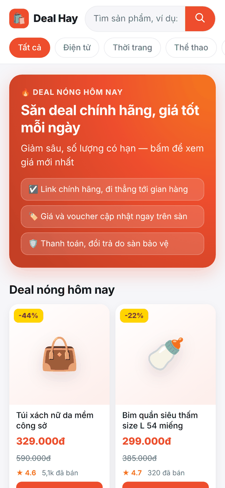
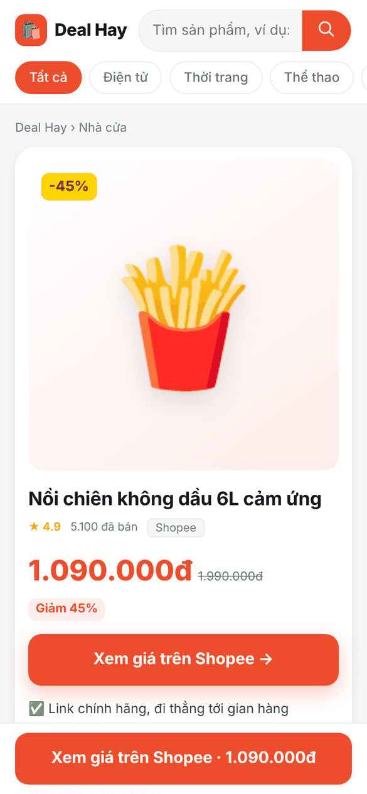

<div align="center">

# 🛍️ VN Affiliate Shop

**Web affiliate Shopee/Lazada/TikTok Shop của riêng bạn trong 5 phút. Miễn phí, mã nguồn mở.**

Bạn dán link sản phẩm, web tự gắn mã affiliate của bạn vào. Khách bấm mua là bạn nhận hoa hồng.

[](https://www.hostinger.com/docker-hosting?compose_url=https://raw.githubusercontent.com/ntm4131/vn-affiliate-shop/main/docker-compose.yml&REFERRALCODE=7OMBANTHUQMO)

PHP 8 · SQLite · Không cần MySQL · Không cần framework · Chạy mượt trên điện thoại

 

</div>

---

## Vì sao dùng?

| | |
|---|---|
| 💸 **Ra tiền ngay** | Mọi nút "Xem giá" đi qua `/go/<id>`, tự gắn `affiliate_id` + `sub_id` của bạn và đếm lượt bấm. |
| 📱 **Đẹp trên điện thoại** | Lưới 2 cột, nút mua dính đáy màn, tải nhanh. 80% khách affiliate vào bằng điện thoại. |
| 🔎 **Chuẩn SEO** | Dữ liệu cấu trúc Product, Breadcrumb, Organization, có sẵn `sitemap.xml`, `robots.txt`, URL tiếng Việt không dấu. |
| ⚡ **Nhập nghìn sản phẩm một lúc** | Tải tệp CSV xuất từ Shopee Affiliate hoặc Google Sheets lên là xong. |
| 🛠️ **Quản trị gọn** | `/admin`: thêm, sửa, xoá, đánh dấu deal nóng, đổi màu thương hiệu, gắn mã Google Analytics hoặc Pixel. |
| 🌏 **Song ngữ** | Tiếng Việt và English, đổi bằng một ô trong cài đặt. |

## Cài đặt

### Cách 1: Một cú bấm trên Hostinger (dễ nhất)

1. Bấm nút **Deploy to Hostinger** ở trên rồi chọn gói VPS. Gói nhỏ nhất là đủ.
2. Chờ khoảng 1 phút để Docker Manager tự chạy `docker-compose.yml`.
3. Mở `http://<IP-VPS>/admin`, đặt tên web và mật khẩu. Vào **Cài đặt** rồi dán mẫu link affiliate của bạn.

> Trỏ tên miền: tạo bản ghi `A` từ tên miền tới IP của VPS. Sau đó điền `https://tenmien.vn` vào ô *Địa chỉ web* trong cài đặt để sitemap đúng tên miền.

### Cách 2: Máy có Docker

```bash
curl -O https://raw.githubusercontent.com/ntm4131/vn-affiliate-shop/main/docker-compose.yml
docker compose up -d        # mở http://localhost
```

### Cách 3: Không dùng Docker (PHP 8.1+ có pdo_sqlite)

```bash
git clone https://github.com/ntm4131/vn-affiliate-shop && cd vn-affiliate-shop
php -S localhost:8000 -t public public/index.php
```

Trên hosting thường (cPanel hoặc hPanel): tải cả thư mục lên, trỏ gốc web vào `public/`. Thư mục `data/` phải ghi được.

## Gắn mã affiliate

Trong **/admin → Cài đặt → Mẫu link affiliate**, ví dụ với Shopee:

```
https://s.shopee.vn/an_redir?origin_link={url}&affiliate_id=MÃ_CỦA_BẠN&sub_id={sub}
```

| Biến | Ý nghĩa |
|---|---|
| `{url}` | Link sản phẩm đã mã hoá |
| `{raw}` | Link sản phẩm gốc |
| `{sub}` | `sub_id`, dùng để biết đơn đến từ web nào |

Link nào đã là link affiliate (`s.shopee.vn/…` hoặc có `affiliate_id=`) thì được giữ nguyên.

## Nhập CSV

Dòng đầu là tên cột. Chỉ `name` và `link` là bắt buộc.

```csv
name,link,price,old_price,category,image,rating,sold,shop,description,hot
Tai nghe bluetooth ANC,https://shopee.vn/...,459000,890000,Điện tử,https://...jpg,4.8,1200,Shopee,Chống ồn chủ động,1
```

## Biến môi trường (không bắt buộc)

| Biến | Mặc định | Ghi chú |
|---|---|---|
| `SITE_NAME` | Deal Hay | Có thể đổi trong /admin |
| `SITE_LANG` | vi | `vi` hoặc `en` |
| `ADMIN_PASSWORD` | trống | Để trống thì lần đầu vào /admin sẽ tự hỏi tạo mật khẩu |
| `AFFILIATE_TEMPLATE` | trống | Mẫu link như ở trên |
| `SITE_URL` | tự nhận | `https://tenmien.vn` |
| `APP_REF` | main | Nhánh hoặc thẻ phiên bản muốn chạy |
| `PORT` | 80 | Cổng mở ra ngoài |

Dữ liệu (SQLite và cài đặt) nằm trong volume `shop_data`. Khởi động lại container sẽ tự tải bản mã mới nhất mà không mất dữ liệu.

## ⚡ Bản Pro

Bản miễn phí đủ để chạy một web affiliate thật. Khi muốn làm lớn thì có **bản Pro** tại **[sitetot.com](https://sitetot.com)**:

- Máy **tự lấy hàng nghìn sản phẩm Shopee đúng ngách mỗi đêm**, có giá, ảnh, đánh giá thật
- Nhiều sàn một lúc: Shopee, Lazada, TikTok Shop, Tiki, Amazon
- Nhiều giao diện theo ngách, bài viết SEO có sẵn, nút chấm điểm, vuốt sản phẩm, Zalo nổi
- Ví điểm thưởng cho khách và nút đặt quảng cáo để có thêm thu nhập

---

## English

**Your own Shopee / Lazada / TikTok Shop affiliate storefront in 5 minutes. Free and open source.**

Paste product links and the site wraps them with your affiliate ID. When a visitor buys, you earn the commission. It runs on PHP 8 + SQLite with no database server, is built mobile-first and is SEO-ready (Product and Breadcrumb JSON-LD, sitemap). It also has CSV bulk import, an admin panel and a Vietnamese/English UI.

**Install:** click **Deploy to Hostinger** above, or run `docker compose up -d`, then open `/admin` to set your name, password and affiliate link template.

## Giấy phép · License

[MIT](LICENSE). Bạn được dùng, sửa và bán web dựng từ mã này. Mong bạn giữ lại dòng "Dựng bằng mã nguồn mở" ở chân trang.
